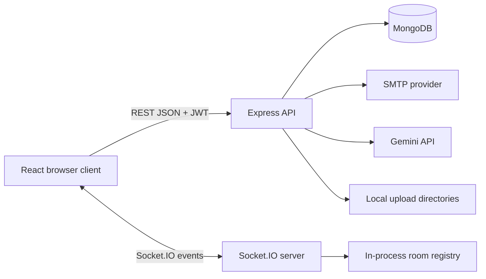

# SkillSphere

SkillSphere is a full-stack skill development, peer-learning, and mentorship platform. The repository contains a React 19 and Vite client, an Express 5 API, MongoDB/Mongoose models, and Socket.IO room communication.

The application brings together user accounts, profiles, skill discovery, connection requests, messaging, learning rooms, recording-related workflows, and an AI assistant endpoint. It is an active development project. Several operational and security gaps remain, so it should not be presented as production-ready without the hardening described in this handbook.

<p align="center">
  
  
  
  
  
  
</p>

## Contents

- [Product overview](#product-overview)
- [Current capabilities](#current-capabilities)
- [Technology stack](#technology-stack)
- [System requirements](#system-requirements)
- [Local development](#local-development)
- [Environment configuration](#environment-configuration)
- [Application workflows](#application-workflows)
- [Repository structure](#repository-structure)
- [Architecture](#architecture)
- [API and realtime interfaces](#api-and-realtime-interfaces)
- [Uploads and data](#uploads-and-data)
- [Build, lint, and validation](#build-lint-and-validation)
- [Deployment checklist](#deployment-checklist)
- [Known limitations and security concerns](#known-limitations-and-security-concerns)
- [Documentation index](#documentation-index)
- [Contributing](#contributing)
- [License](#license)

## Product overview

SkillSphere is intended to support a learning community where users can present their skills, discover other learners or mentors, connect with people, and collaborate in online rooms. The application combines conventional HTTP endpoints for account and profile operations with Socket.IO events for live room interactions.

The codebase currently includes the following user-facing areas:

- Registration, email OTP verification, login, logout, and password reset.
- Dashboard and profile data.
- Skill and profile discovery.
- Connection requests and connection notifications.
- Direct messaging and file sharing.
- Rooms with participants, host actions, hand raising, screen-sharing request events, and meeting lifecycle events.
- Recording metadata and recording file routes.
- An authenticated AI assistant backed by the Google Generative AI SDK.

Feature names describe code paths present in this repository. They are not a guarantee that every flow is fully secured, persistent across multiple server instances, or production tested.

## Current capabilities

| Area | Implementation in this repository | Notes |
|---|---|---|
| Accounts | Express routes and MongoDB user model | Password hashing uses bcryptjs; JWT is used by protected middleware |
| Email verification | OTP model and Nodemailer | OTP generation, expiration, and abuse controls need review |
| Profiles | Profile and user models with profile controllers | Some profile routes are not protected at the route layer |
| Connections | Connection model and controller | Request/accept/reject workflows |
| Direct messages | Message model and message controller | Authenticated REST endpoints and file upload |
| Rooms | Room model and room controller | Persistent room records plus in-memory Socket.IO participant state |
| Live events | Socket.IO server | Current socket connection setup does not authenticate each socket |
| Recordings | Recording model and local upload routes | Local disk storage, not object storage |
| AI assistant | Authenticated `/api/ai/ask` endpoint | Uses server-side `GEMINI_API_KEY`; model identifier is currently fixed in controller |

## Technology stack

| Layer | Main technologies |
|---|---|
| Frontend | React 19, Vite 6, React Router |
| UI and interaction | Tailwind CSS 4, Framer Motion, Heroicons, Lucide, React Icons |
| API server | Node.js, Express 5 |
| Persistence | MongoDB, Mongoose |
| Authentication | JWT, bcryptjs, express-session |
| Realtime | Socket.IO and socket.io-client |
| Email | Nodemailer |
| Upload handling | Multer and local filesystem directories |
| AI integration | `@google/generative-ai` |
| Quality tooling | ESLint, GitHub Actions, Node syntax checks |

The backend and frontend are separate npm projects. Install dependencies in each directory. The root package manifest is not the application runtime entry point.

## System requirements

- Node.js 20 or a compatible current LTS release.
- npm, using the lockfiles committed in the repository.
- MongoDB, local or hosted.
- SMTP credentials for email verification and password reset.
- A Gemini API key if the AI assistant is enabled.
- A modern browser with WebRTC support for room media features.
- Git for cloning and contributing.

## Local development

### 1. Clone the repository

```bash
git clone https://github.com/Brajesh31/SkillSphere.git
cd SkillSphere
```

### 2. Install and configure the backend

```bash
cd backend
npm ci
cp .env.example .env
```

On Windows PowerShell, use `Copy-Item .env.example .env` instead of `cp`.

Edit `backend/.env` and set the values described in [Environment configuration](docs/ENVIRONMENT.md). At minimum, configure MongoDB, unique JWT and session secrets, and SMTP credentials for account verification.

Start the API:

```bash
npm run dev
```

The backend uses port 5000 by default. It logs a MongoDB connection failure and may still start in development mode, but database-backed features will not work correctly without MongoDB.

### 3. Install and configure the frontend

Open a second terminal from the repository root:

```bash
cd frontend
npm ci
cp .env.example .env
npm run dev
```

The Vite development server normally uses port 5173. The API client uses `VITE_API_BASE_URL`, defaulting to `http://localhost:5000`.

### 4. Open the application

Open the local address printed by Vite. Keep MongoDB, the backend, and the frontend running while testing.

### 5. Stop local processes

Use Ctrl+C in each terminal. The application currently does not provide a persistent data backup or a production-grade shutdown workflow.

## Environment configuration

Backend variables belong in `backend/.env` and must remain server-side.

| Variable | Required for | Description |
|---|---|---|
| `PORT` | API | HTTP server port, defaults to 5000 |
| `NODE_ENV` | API | Use `development` locally and `production` in deployment |
| `MONGODB_URI` | Database | MongoDB connection string |
| `JWT_SECRET` | Authentication | Long, random signing secret |
| `SESSION_SECRET` | Sessions | Separate long, random session signing secret |
| `EMAIL_USER` | Email | SMTP account used by Nodemailer |
| `EMAIL_PASS` | Email | SMTP app password or provider credential |
| `GEMINI_API_KEY` | AI assistant | Server-side Google Gemini API key |

Frontend configuration is public. `VITE_API_BASE_URL` is compiled into browser assets and must never contain a secret. Read [Environment configuration](docs/ENVIRONMENT.md) before deploying.

## Application workflows

### Account registration and authentication

The backend exposes signup, OTP verification, login, logout, dashboard, and current-user routes under `/api/auth`. Passwords are hashed with bcryptjs. Login issues a JWT, and the `protect` middleware validates bearer tokens for protected routes.

### Profiles and discovery

Profile routes support profile retrieval and updates, exploration, mentor-by-skill lookup, endorsements, and statistics. Route-level authentication is not applied consistently across all profile handlers. Treat public profile access and write authorization as a security review item, not an assumed guarantee.

### Connections and messages

Authenticated connection endpoints allow users to send requests, respond to requests, list connections, and retrieve pending requests. Message endpoints support sending and retrieving direct messages, read state, and file transfer. Review ownership checks and request validation before exposing these endpoints to untrusted clients.

### Rooms and live collaboration

Room HTTP routes create and join room records and expose recording operations. Socket.IO events coordinate participant lists, room messages, host actions, screen-sharing requests, hand raising, and participant departures. The current participant registry is held in process memory, and socket authentication is not established by the current initialization code.

### AI assistant

The authenticated endpoint `POST /api/ai/ask` accepts a message and optional context, calls the configured Gemini model, and returns an answer. Do not send passwords, access tokens, private user records, or other sensitive content as model context.

## Repository structure

```text
.
├── .github/
│   ├── ISSUE_TEMPLATE/
│   ├── PULL_REQUEST_TEMPLATE.md
│   └── workflows/
├── backend/
│   ├── controllers/       # Account, profile, connection, room, message, AI logic
│   ├── middleware/        # JWT authentication middleware
│   ├── models/            # Mongoose schemas
│   ├── routes/             # HTTP route definitions
│   ├── uploads/            # Local uploaded files (currently tracked content exists)
│   ├── .env.example
│   ├── package.json
│   └── server.js
├── docs/                   # Technical and operational documentation
├── frontend/
│   ├── public/
│   ├── src/
│   │   ├── api/
│   │   ├── components/
│   │   ├── context/
│   │   ├── pages/
│   │   └── styles/
│   ├── .env.example
│   └── package.json
├── CONTRIBUTING.md
├── CODE_OF_CONDUCT.md
├── LICENSE
├── README.md
└── SECURITY.md
```

The repository currently contains uploaded PDFs, documents, recordings, and profile images under `backend/uploads/`. These appear as tracked files in Git. They should be reviewed for ownership, consent, privacy, and redistribution rights before the repository is shared or deployed. See [Uploads and privacy](docs/UPLOADS-AND-PRIVACY.md).

## Architecture



The browser communicates with Express through Axios and with Socket.IO for live room events. Express reads and writes MongoDB documents, sends email through Nodemailer, invokes Gemini for AI requests, and serves selected local upload directories. The realtime room registry is separate from MongoDB and is currently process-local.

See [Architecture](docs/ARCHITECTURE.md) and [Realtime rooms](docs/REALTIME-ROOMS.md) for implementation details and scaling constraints.

## API and realtime interfaces

The route inventory and authentication expectations are documented in [API reference](docs/API.md). The principal route groups are:

| Prefix | Responsibility |
|---|---|
| `/api/auth` | Registration, verification, login, reset, dashboard, current user |
| `/api/profile` | Profiles, discovery, endorsements, mentor lookup, profile stats |
| `/api/connections` | Connection requests, responses, search, notifications |
| `/api/messages` | Direct messages, file sending, read state |
| `/api/rooms` | Room creation/joining and recording operations |
| `/api/stats` | Statistics endpoints |
| `/api/ai` | AI assistant requests |

Socket event names and current trust boundaries are listed in [Realtime rooms](docs/REALTIME-ROOMS.md).

## Uploads and data

Multer writes message files and recordings to local directories, while profile assets are also stored locally. Express serves several upload directories as static paths. This is suitable only for a controlled development environment unless file validation, access control, malware scanning, storage quotas, retention, and durable backup are added.

The project should not commit real user uploads. The existing tracked upload content requires a deliberate privacy and repository-history review. Do not delete or rewrite user data as part of a documentation-only change.

## Build, lint, and validation

From `frontend/`:

```bash
npm ci
npm run build
npm run lint
```

From `backend/`:

```bash
npm ci
find . -name '*.js' -not -path '*/node_modules/*' -print0 | xargs -0 -n1 node --check
```

The full frontend lint command currently has known failures. The repository's quality workflow uses a narrower lint check for the API client and runs the frontend production build plus backend syntax checks. A passing workflow must not be interpreted as a clean full-project lint result or as proof of runtime security.

See [Testing and quality](docs/TESTING.md).

## Deployment checklist

Before exposing the service publicly:

- [ ] Rotate any previously exposed Gemini, SMTP, JWT, or session credentials.
- [ ] Configure production MongoDB with least-privilege credentials and backups.
- [ ] Set unique production JWT and session secrets.
- [ ] Restrict Express CORS and Socket.IO origins to the actual frontend origin.
- [ ] Add Socket.IO authentication and authorize each room event against persisted membership.
- [ ] Review authorization on every profile, connection, message, room, and recording endpoint.
- [ ] Add rate limits and abuse controls for signup, OTP, login, password reset, AI, and uploads.
- [ ] Fix OTP expiry semantics and prevent brute-force verification attempts.
- [ ] Enforce upload type, size, ownership, and download authorization.
- [ ] Move uploads to private durable object storage.
- [ ] Use HTTPS, secure cookies, trusted proxy settings, and production logging.
- [ ] Add automated tests for authentication, authorization, and realtime flows.
- [ ] Remove test-only authentication fallback behavior before production.
- [ ] Review tracked upload files and remove any content without clear permission through a separately approved cleanup.

More details are in [Deployment](docs/DEPLOYMENT.md) and [Security review](docs/SECURITY-REVIEW.md).

## Known limitations and security concerns

The code review surfaced important gaps that should be resolved before production use:

1. The Socket.IO connection setup does not authenticate the socket. Several room events trust client-supplied user IDs and room IDs.
2. Express CORS and Socket.IO origins are hard-coded to localhost development origins.
3. Several profile routes and room operations mounted through the profile router do not consistently use the authentication middleware.
4. OTP creation uses a five-minute MongoDB TTL while the email text says ten minutes. OTP rate limiting and attempt limits are not evident in the inspected implementation.
5. The direct-message and upload paths need ownership checks, strict validation, and controlled file access.
6. The development fallback login in the authentication controller should not be available in a production build.
7. The statistics controllers mix session-based and JWT-based identity patterns, and some statistics are mock values.
8. Room participant state is process-local and will not coordinate across multiple server instances.
9. The frontend's full ESLint run has existing violations. The CI workflow's narrower lint step does not clear that backlog.
10. User-uploaded files are present in Git history and require a privacy and licensing review.

These are documented findings, not fixes. Do not assume a documentation commit resolves them.

## Documentation index

| Document | Purpose |
|---|---|
| [Architecture](docs/ARCHITECTURE.md) | Components, request flow, boundaries, and runtime topology |
| [API reference](docs/API.md) | HTTP route inventory, auth notes, and request conventions |
| [Environment configuration](docs/ENVIRONMENT.md) | Backend secrets and public frontend settings |
| [Data model](docs/DATA-MODEL.md) | Main MongoDB entities and relationships |
| [Realtime rooms](docs/REALTIME-ROOMS.md) | Socket.IO event families and current limitations |
| [Uploads and privacy](docs/UPLOADS-AND-PRIVACY.md) | Local file handling and data protection requirements |
| [Deployment](docs/DEPLOYMENT.md) | Production setup and operational checklist |
| [Security review](docs/SECURITY-REVIEW.md) | Code-observed risks and remediation priorities |
| [Testing and quality](docs/TESTING.md) | Existing CI coverage and manual test plan |
| [Troubleshooting](docs/TROUBLESHOOTING.md) | Common local development failures |
| [Roadmap](docs/ROADMAP.md) | Staged engineering priorities |

## Contributing

Read [CONTRIBUTING.md](CONTRIBUTING.md) before submitting changes. Keep pull requests focused, include evidence for validation, update docs when behavior changes, and never commit credentials or private uploads.

## Community standards

Participation is covered by [CODE_OF_CONDUCT.md](CODE_OF_CONDUCT.md).

## Security

Report vulnerabilities privately according to [SECURITY.md](SECURITY.md). Do not publish sensitive exploit details or private user data in public issues.

## License

MIT. See [LICENSE](LICENSE).
