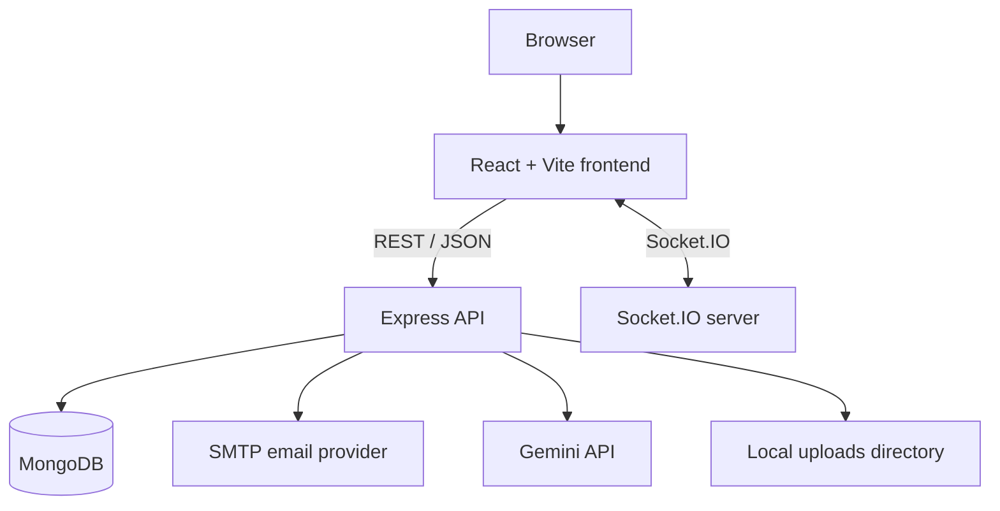

# SkillSphere

SkillSphere is a MERN-based skill development and mentorship platform. It combines a React frontend with an Express API and MongoDB data models for accounts, profiles, connections, rooms, messages, and recordings.

<p align="center">
  
  
  
  
  
</p>

## Features implemented in the codebase

- Account registration with email OTP verification.
- Login, JWT-based protected API routes, and password reset flow.
- User profiles and profile editing.
- Explore users and manage connection requests.
- Room creation and joining.
- Real-time room participant updates and chat events through Socket.IO.
- Screen-sharing request and approval events.
- Recording-related routes and recording storage.
- AI assistant endpoint backed by Google's Gemini API.

The exact behavior depends on the current backend and frontend implementation. This project should be treated as an active development codebase, not a production-ready service.

## Technology

| Layer | Technology |
|---|---|
| Frontend | React 19, Vite, React Router |
| UI | Tailwind CSS, Framer Motion, Heroicons, Lucide |
| API | Node.js, Express 5 |
| Database | MongoDB, Mongoose |
| Authentication | JWT, bcryptjs, email OTP, express-session |
| Real-time | Socket.IO |
| AI | Google Generative AI SDK |
| Email | Nodemailer |
| Uploads | Multer and local upload directories |

## Requirements

- Node.js 20 or later
- npm
- MongoDB instance, local or hosted
- Gmail app password or compatible SMTP credentials for OTP email
- Google Gemini API key for the AI assistant

## Local setup

### 1. Clone the repository

```bash
git clone https://github.com/Brajesh31/SkillSphere.git
cd SkillSphere
```

### 2. Configure the backend

```bash
cd backend
npm ci
cp .env.example .env
```

Set the values in `backend/.env`:

| Variable | Purpose |
|---|---|
| `PORT` | API port, defaults to `5000` |
| `MONGODB_URI` | MongoDB connection string |
| `JWT_SECRET` | Secret used to sign authentication tokens |
| `SESSION_SECRET` | Express session signing secret |
| `EMAIL_USER` | SMTP/Gmail account used to send OTP messages |
| `EMAIL_PASS` | SMTP/Gmail app password |
| `GEMINI_API_KEY` | Server-side Gemini API key |

Start the API:

```bash
npm run dev
```

### 3. Configure the frontend

Open a second terminal:

```bash
cd frontend
npm ci
cp .env.example .env
npm run dev
```

The Vite development server normally runs at `http://localhost:5173`. The frontend API client defaults to `http://localhost:5000`; set `VITE_API_BASE_URL` if your local API uses another address.

### 4. Open the application

Visit the local URL printed by Vite. Keep the backend, MongoDB, and frontend running while using the application.

## Repository structure

```text
backend/
├── controllers/     # Authentication, profile, room, AI, and messaging logic
├── middleware/      # Authentication middleware
├── models/          # Mongoose models
├── routes/          # Express API routes
├── uploads/         # Local profile, message, and recording uploads
└── server.js        # Express and Socket.IO server
frontend/
├── src/
│   ├── api/         # API client
│   ├── components/  # Shared UI components
│   ├── context/     # Room context
│   └── pages/       # Application pages
└── package.json
```

## High-level architecture



## Useful scripts

| Directory | Command | Purpose |
|---|---|---|
| `backend` | `npm run dev` | Start API with nodemon |
| `backend` | `npm start` | Start API |
| `frontend` | `npm run dev` | Start Vite |
| `frontend` | `npm run lint` | Run ESLint |
| `frontend` | `npm run build` | Build frontend |
| `frontend` | `npm run preview` | Preview production build |

## Deployment considerations

Before deploying, configure production MongoDB, strong unique JWT/session secrets, SMTP credentials, Gemini key, frontend API URL, and allowed CORS origins. The current CORS and Socket.IO origin settings include local development addresses and must be reviewed for the deployed domain.

Room participant state is held in memory by the current Socket.IO server. Multiple server instances will require a shared Socket.IO adapter or another shared coordination layer. Local uploads should be moved to durable object storage for production.

Do not commit real user uploads. Review existing tracked files under `backend/uploads/` before publishing or distributing this repository.

## Security

A Gemini API key previously embedded in backend source has been removed. Rotate that key in Google AI Studio. Removing a secret from the latest commit does not remove it from Git history. Read [SECURITY.md](SECURITY.md) before deployment.

## Contributing

See [CONTRIBUTING.md](CONTRIBUTING.md) for setup and pull request expectations.

## License

MIT. See [LICENSE](LICENSE).
