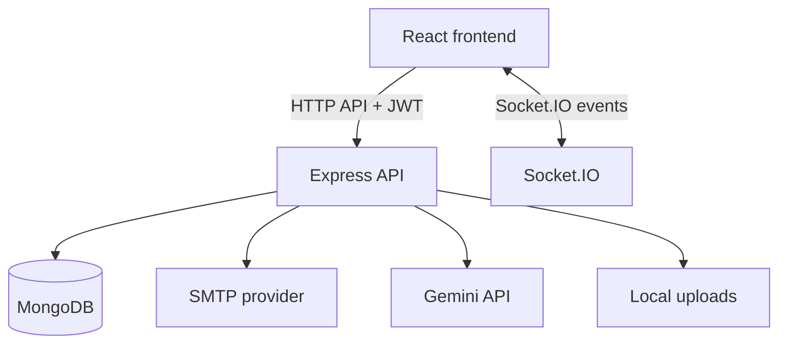

# Architecture

SkillSphere is split into a React client and an Express API backed by MongoDB.

## Frontend

- `frontend/src/pages/`: route-level screens for authentication, dashboard, profiles, exploration, connections, and rooms.
- `frontend/src/components/`: shared interface components, chat UI, profile UI, and participant controls.
- `frontend/src/api/axiosConfig.js`: API client and JWT request header.
- `frontend/src/context/`: shared room state.

## Backend

- `backend/routes/`: HTTP API route registration.
- `backend/controllers/`: authentication, profiles, connections, messages, rooms, statistics, and AI behavior.
- `backend/models/`: Mongoose schemas.
- `backend/middleware/`: authentication middleware.
- `backend/server.js`: Express, sessions, MongoDB connection, static upload routes, and Socket.IO initialization.

## Request flow

## Operational constraints

Room participant coordination is currently in process memory. The configured CORS origins include local development addresses. Local upload directories are served by Express. These choices need review before production deployment or horizontal scaling.
