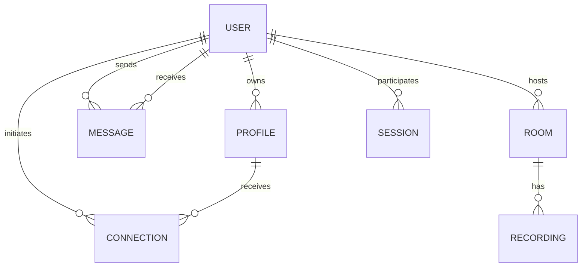

# Data Model

This guide describes the Mongoose model files currently present in `backend/models/`. It is a source-oriented overview, not a complete database schema contract. Some controllers use both User and Profile records, and the application has legacy or overlapping fields that should be reconciled before schema migrations.

## User

Defined in `User.js`. The user record includes:
- Identity fields: full name, username, email, password hash, verification state.
- Role: student, mentor, or both.
- Profile-related values: photo, skills, bio, last active timestamp.
- Progress: XP points, level number, progress percentage, badges.
- Embedded sessions and connection references.

The username and email fields are marked unique in the schema. The password field stores the bcrypt hash, not the original password. Controllers should always exclude the password from API responses.

The model also defines embedded session and badge schemas. Session entries include mentor, mentee, duration, date, skills practiced, rating, and feedback. Badges include name, description, earned date, and type.

## Profile

The Profile model is used by profile and connection controllers. It stores profile data such as user reference, skills, bio, avatar, and related profile information. Consult `backend/models/Profile.js` before changing profile behavior because the codebase uses both User and Profile representations.

## Connection

Defined in `Connection.js`. A connection record includes:
- `userId`: user who initiated the request.
- `connectedProfileId`: target Profile record.
- `status`: pending, accepted, or rejected.
- Snapshot fields such as avatar, username, skills, and bio.
- Creation timestamp.

The connection controller creates a reverse accepted record when a request is accepted. This duplication strategy should be kept consistent and protected against concurrent duplicate requests.

## Room

Defined in `Room.js`. A room record includes:
- Unique `meetingId`.
- Name and optional password.
- Maximum participants and planned duration.
- Host user reference.
- Participant metadata.
- Creation and end timestamps.

The Room document is persistent, but the active Socket.IO participant registry and screen-share state are maintained separately in memory by the room controller. A MongoDB room document does not prove that a socket participant is authenticated or currently connected.

## Message

Defined in `Message.js`. Direct messages include sender and receiver user references, content, seen state, and creation timestamp. File messages may be represented through additional controller/model behavior. Verify the actual message controller before changing the stored content contract.

## OTP

Defined in `Otp.js`. OTP records contain email, OTP value, and a creation timestamp with a MongoDB TTL expiration of 300 seconds. The email copy in the authentication controller currently says ten minutes. The discrepancy should be corrected and tested. OTP values should not be logged or returned to clients.

## Recording

A Recording model stores recording metadata. The room controller uses this model together with files stored under `backend/uploads/recordings`. Metadata and file bytes have different lifecycle requirements: deleting one without the other can leave orphaned data.

## Session

A Session model exists separately from the embedded session schema in User. Review references and actual controller usage before removing or merging either representation.

## Relationships at a glance

The diagram is conceptual. Exact cardinality and reference paths should be checked against the current model definitions and controller population calls.

## Data integrity recommendations

- Add explicit required fields and validation for user-controlled values.
- Normalize email addresses and usernames consistently before unique checks.
- Handle duplicate-key errors as expected validation outcomes.
- Add indexes for frequently queried foreign keys and timestamps after measuring query patterns.
- Define deletion and retention behavior for user, profile, message, recording, and upload data.
- Ensure all reads and writes are scoped to the authenticated user or an authorized role.
- Avoid storing redundant profile snapshots unless their update semantics are defined.
- Use transactions for multi-document operations where partial completion would create inconsistent state.
